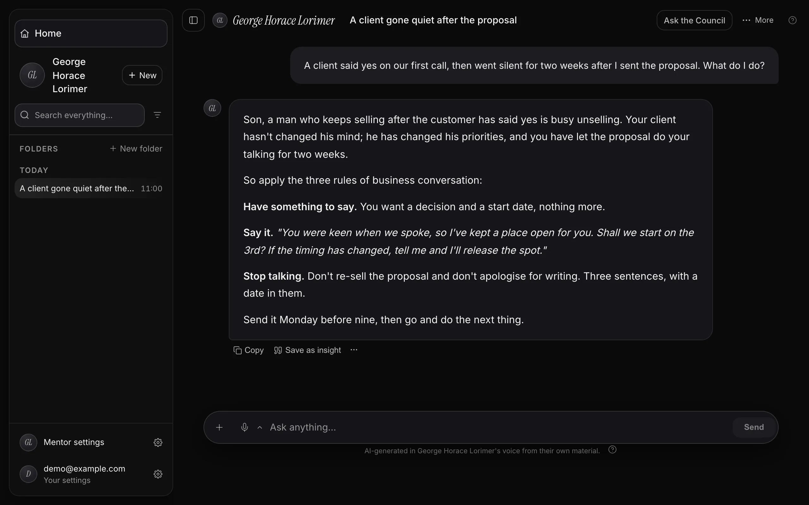
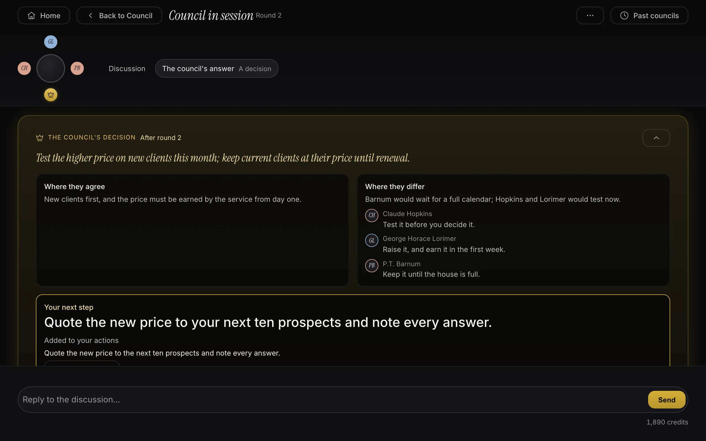
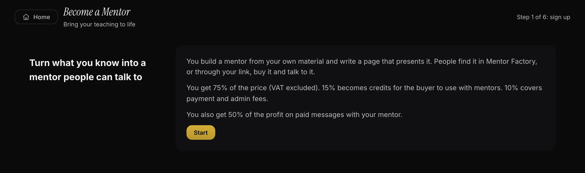

 

   

**[Download](#download)** · **[What it does](#what-it-does)** · **[Questions](#questions)** · **[mentorfactory.ai](https://mentorfactory.ai)**

---

Mentor Factory turns the books, courses and teachings you trust into mentors you can talk to. Months of reading become an answer in seconds, in the voice and judgment of the person who wrote it.

## Download

| Platform | Installer | |
|---|---|---|
| **macOS** (Apple Silicon) | `MentorFactory-v<version>.dmg` | [**Download**](https://github.com/Albedoengib/mentorfactory-releases/releases/latest) |
| **Windows** (64-bit) | `MentorFactory-v<version>-x64-setup.exe` | [**Download**](https://github.com/Albedoengib/mentorfactory-releases/releases/latest) |

The easiest way is **[mentorfactory.ai/download](https://mentorfactory.ai/download/)**. Once installed, Mentor Factory updates itself.

Each file's SHA-256 checksum is shown next to it on the [release page](https://github.com/Albedoengib/mentorfactory-releases/releases/latest), so you can confirm your download is untouched.

## What it does

<table>
<tr>
<td width="50%" valign="top">

### Mentors that know you
Ask a mentor built from a book, a course or a teacher's work. It answers from that source, and from what it knows about you.

Three mentors come with the app, built from classics free of copyright: **George Horace Lorimer** (business judgment), **Claude Hopkins** (marketing and copy) and **P.T. Barnum** (money and promotion). Ask any of them two questions before you even sign in.

</td>
<td width="50%"></td>
</tr>
<tr>
<td width="50%"></td>
<td width="50%" valign="top">

### Your Council of Advisors
Bring several mentors to the same question. You choose whose thinking answers you, and see where they agree and where they don't.

</td>
</tr>
<tr>
<td width="50%" valign="top">

### Bring your teaching to life
Have a course, a method or a body of work? Turn it into a mentor others can learn from, and earn from every conversation.

### Agents that do the work
Mentors don't stop at advice. They turn it into actions and steps you can follow through.

</td>
<td width="50%"></td>
</tr>
</table>

## Questions

<b>Is Mentor Factory free?</b>

 
There is a free plan, forever, plus paid plans: Mentor Guides and Mentor Workforce. See <a href="https://mentorfactory.ai/#pricing">pricing</a>.

<b>What about my privacy?</b>

 
Mentor Factory is private by design. Read the <a href="https://mentorfactory.ai/legal/privacy/">privacy policy</a>.

<b>Where is the source code?</b>

 
Mentor Factory is closed-source software. This repository only distributes the official installers. GitHub automatically attaches "Source code (zip)" and "Source code (tar.gz)" to every release; here they contain only this page and its pictures. They are not the app and you don't need them.

<b>How do I get help?</b>

 
Use <b>Send feedback</b> inside the app, or write to <a href="mailto:support@mentorfactory.ai">support@mentorfactory.ai</a>.

---

 
<a href="https://mentorfactory.ai">mentorfactory.ai</a>

